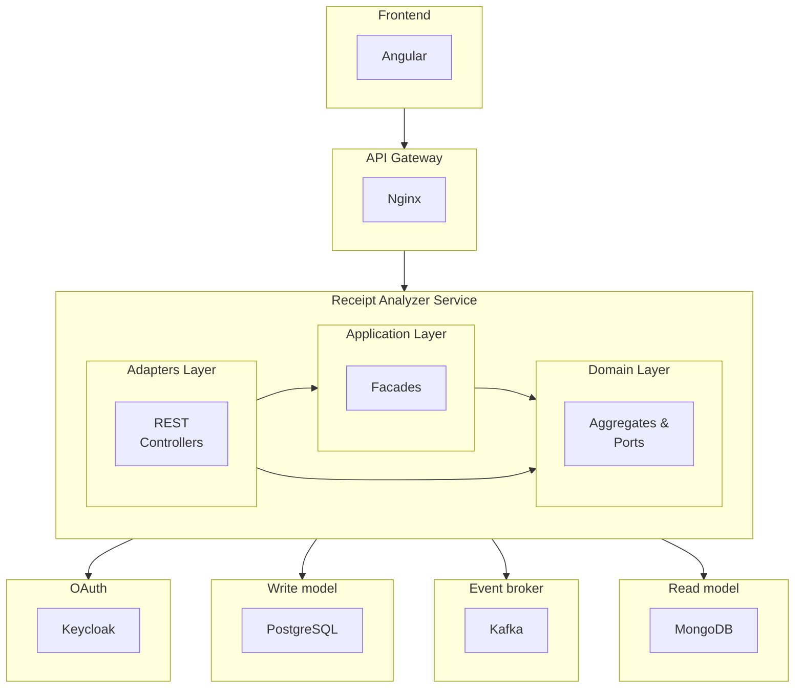

# Receipt Analyzer - Receipt Digitization and Expense Tracking 

A modular web application for receipt digitization and expense tracking with advanced OCR processing. Created to collect training data for an ML model.

---

## Project Description

**Receipt Analyzer** is a comprehensive solution for:
- Receipt and invoice digitization with automatic text recognition (OCR)
- Organizing expenses in wallets
- Product categorization
- Secure access management through Keycloak
- Responsive web interface

**Key Features:**
- Automatic data extraction from PDF and JSON receipts
- Support for multiple receipt formats
- Receipt files kept as file groups (PDF, JPEG/PNG/WEBP images, JSON exports)
- Image editor: rotate and crop receipt photos, the result is saved as a new file group and the original stays untouched
- Versioning system created for training an ML model to read receipt data
- Editing receipt items with product autocomplete on the item name (free text still allowed) and CSV paste from the clipboard
- Product dictionary management, with aliases learned from user corrections
- Per-user data isolation: wallets, receipts and files are visible only to their owner
- Edits made from stale data are rejected (optimistic locking) instead of silently overwriting newer changes
- Authentication and authorization via Keycloak
- Angular Material interface


---

## Architecture

### Architectural Pattern

The backend is a modular monolith built with Hexagonal Architecture, DDD aggregates and CQRS:

- **Layers** are separate Gradle modules: `domain` (aggregates and write-side ports, no Spring), `app` (facades with the use cases, read-side ports), `adapters` (REST, JPA, MongoDB, Kafka, security) and `monolith` (the Spring Boot entry point).
- **Features** (`receipt`, `digitization`, `file_group`, `product_dict`, `store`, `wallet`, `user`) are Spring Modulith modules.
- **Writes** go through aggregates to PostgreSQL, the source of truth. Each saved aggregate produces an event, which the application stores in an outbox table in the same transaction. After the commit, Spring Modulith sends it to Kafka and retries if sending fails. PostgreSQL itself never talks to Kafka.
- **Reads** are served from a MongoDB read model. The application consumes the events from Kafka and projects them into MongoDB. It can be rebuilt from PostgreSQL at any time, and a client can wait until its own last change is visible.


---

## Tech Stack

### Backend
```
Language:           Java 21
Framework:          Spring Boot 3.5
Build Tool:         Gradle (multi-module: domain, app, adapters, monolith)
Modules & events:   Spring Modulith 1.4
Write model:        PostgreSQL 17, Hibernate JPA
Read model:         MongoDB 8 (Spring Data MongoDB)
Event broker:       Apache Kafka 3.9 (KRaft, Spring Kafka)
Migrations:         Flyway
Authentication:     Keycloak 26.3 (OAuth2 resource server, JWT)
OCR:                Tesseract (tess4j)
File type detection: Apache Tika
Tests:              JUnit 5, AssertJ, Testcontainers (PostgreSQL, MongoDB, Kafka)
```

### Frontend
```
Language:           TypeScript 5.8
Framework:          Angular 20.1
UI Library:         Angular Material 20.2, Bootstrap 5.3
```

### Infrastructure
```
Container:          Docker & Docker Compose
Web Server:         Nginx 1.29.3
Orchestration:      Docker Compose
CI/CD:              Jenkins (all tests, backend and web client images, private registry, Dockhand deploy)
```
---

## What Has Been Done?

### Core Functionality
- [x] Authentication and authorization via Keycloak
- [x] PDF file upload and processing
- [x] OCR receipt processing
- [x] Support for multiple receipt formats
- [x] Versioning system to track data corrections (for ML training)
- [x] Product dictionary with categorization
- [x] Product aliases system
- [x] Image file groups and image editor (rotate, crop, save as new)
- [x] Manual linking of receipt items to products (autocomplete)
- [x] Stores and store brands
- [x] Per-user ownership of wallets, receipts and files (IDOR protection)
- [x] Optimistic locking on edits
- [x] Database schema versioned with Flyway
- [x] Angular interface

### Architecture and Design
- [x] Hexagonal Architecture
- [x] DDD aggregates: state changes go through domain objects
- [x] Command Query Responsibility Segregation with a MongoDB read model
- [x] Transactional outbox and event externalization to Kafka
- [x] Read model rebuild from PostgreSQL and read-your-writes consistency
- [x] Modular monolith with module boundaries verified by Spring Modulith
- [x] Strategy Pattern for processing different formats

### Infrastructure
- [x] Docker containerization
- [x] Docker Compose setup (prod + local dev)
- [x] Nginx reverse proxy
- [x] Environment configuration
- [x] MongoDB and Kafka in local and production stacks
- [x] Jenkins pipeline: all tests, Docker images for backend and web client, push and deploy

### Tests
- [x] Domain unit tests
- [x] Module structure test (Spring Modulith)
- [x] Backend integration tests (Testcontainers: PostgreSQL, MongoDB, Kafka)

---

## Contact

**Daniel Madzierski**

- Email: daniel.madzierski.pl@gmail.com
- Location: Poznań, Poland